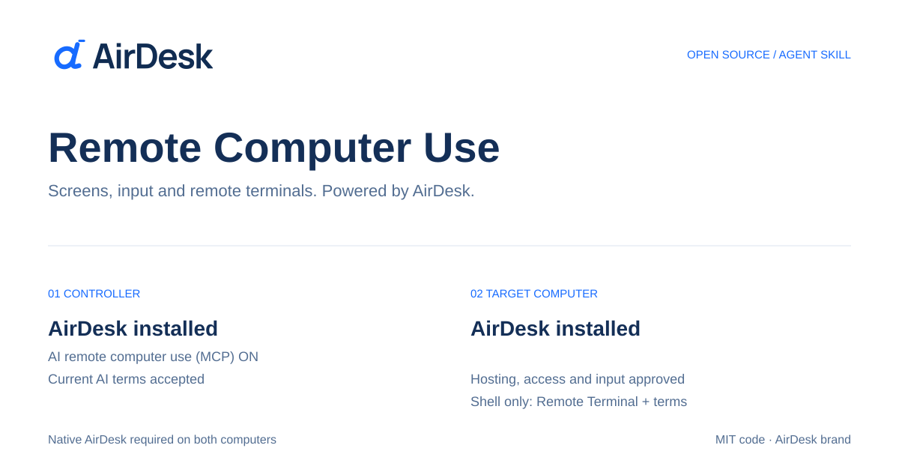

<p align="center">
  
</p>

# AirDesk Remote Computer Use

[English](README.md) · [설치 안내](skills/remote-computer-use/references/setup.md) · [보안](SECURITY.md) · [검증 범위](docs/validation.md)

AirDesk의 네이티브 MCP 서버를 통해 허가된 원격 컴퓨터의 화면을 확인하고,
마우스·키보드·원격 터미널, Windows/macOS 접근성 자동화와 브라우저 UI를 agent-desktop으로 제어하는
오픈소스 **Agent Skill**입니다.

> **양쪽 PC에 AirDesk를 설치하고 제어 PC에서 ‘AI가 원격 컴퓨터 사용’(MCP)을 켜세요.**
> 제어 PC의 앱에서 현재 AI 약관을 확인·동의하세요. 대상 PC는 AirDesk가 실행 중이고
> 소유자가 공유와 접근을 승인해야 합니다. 화면·브라우저 자동화에는 입력 권한도 필요합니다.
> 셸 작업에는 대상의 원격 터미널 설정과 현재 호스트 약관 동의가 추가로 필요합니다.

## 구성

- 동의 확인, 좌표 변환, 결과 검증, 정리 절차를 포함한 [스킬](skills/remote-computer-use/SKILL.md)
- 외부 Python 패키지 없이 동작하는 로컬 진단·MCP 설정 출력 도구
- 스킬 설치·네이티브 MCP 등록·제어 PC의 ‘AI가 원격 컴퓨터 사용’ 활성화를 수행하는 npm 설치기
- **영어·한국어·일본어** 스킬(`--lang en|ko|ja`). 어떤 언어든 같은 `remote-computer-use` 이름으로 설치
- Claude·ChatGPT 커넥터(모바일 앱 포함)와 코딩 에이전트용 **온라인 MCP**(`https://mcp.airdesk.co.kr/mcp`, OAuth 또는 API 키) 지원,
  세 언어의 Claude Code 플러그인 마켓플레이스
- 설치 문서, 보안 지침, 회귀 테스트와 CI
- 기존 AirDesk 로고 및 Figma로 제작한 저장소 표지

## 시작하기

양쪽 PC에 [AirDesk](https://airdesk.co.kr)를 설치하세요. 제어 PC에서 로그인하고 AI 원격 접근
약관을 확인·동의한 뒤 ‘AI가 원격 컴퓨터 사용’을 켜세요.
그다음 **제어 PC의 AI에게 이 GitHub 주소를 설치해 달라고 요청하세요.**

> https://github.com/AirDesk-Inc/remote-computer-use.git 를 설치해줘.
> 이 PC의 AirDesk ‘AI가 원격 컴퓨터 사용’을 켜고 네이티브 MCP 서버도 등록해줘.
> 제어 PC의 원격 터미널 허용은 변경하지 말아줘.

설치기는 기본적으로 `~/.agents/skills/`에 스킬을 설치하고, 기존 Codex 설정을 유지하면서
네이티브 MCP 서버를 등록합니다. 이 PC에 이미 설치된 지원 코딩 에이전트 전부에 한 번에
설치하려면 `--client detected`를, 특정 에이전트만 고르려면 쉼표로 구분한 id
(예: `--client claude-code,cursor,gemini-cli`)를 지정하세요.
[지원 코딩 에이전트](#지원-코딩-에이전트)를 참고하세요.
MCP 활성화는 설치 시 한 번만 수행하며 약관에 자동 동의하지 않습니다.
설치 후 MCP 클라이언트를 다시 로드하세요. 대상 PC에서는 소유자가 호스트 접근을 승인합니다.
셸 작업 전에는 대상의 `targetRemoteTerminal`에서 지원·활성화·현재 약관 동의 여부를 확인하세요.

### AirDesk 또는 GitHub에서 설치

[AirDesk 홈페이지](https://airdesk.co.kr/ko/service#mcp)에서 현재 설치 명령을 복사할 수 있습니다.
아래 예제를 사용하려면 Node.js 22 이상에서 공식 GitHub 저장소를 받은 뒤 그 폴더에서 실행하세요.

```sh
git clone https://github.com/AirDesk-Inc/remote-computer-use.git
cd remote-coumputer-use
npm ci --ignore-scripts
node bin/cli.mjs install                                    # Codex (기본값)
node bin/cli.mjs install --client detected                  # 이 PC에서 찾은 모든 지원 에이전트
node bin/cli.mjs install --client claude-code,cursor
node bin/cli.mjs clients                                    # 에이전트별 경로와 감지 여부
node bin/cli.mjs install --lang ko                          # 한국어 스킬 (en, ko, ja)
node bin/cli.mjs install --mode online --client claude-code
```

**언어.** `--lang`으로 스킬 언어를 고릅니다. 지정하지 않으면 터미널에서 물어보고, 그 밖의
경우에는 시스템 로캘을 따릅니다(알 수 없으면 영어). 폴더 이름, 트리거(`rcu`), MCP 도구 이름은
모든 언어에서 같습니다. 이미 설치한 스킬을 다른 언어로 바꾸려면 `--upgrade`가 필요하며, 이전
사본은 백업으로 남습니다.

### 온라인 MCP·모바일·플러그인

도구 목록에 `direct_host`가 표시되면 기존 홈페이지 API 키 또는 OAuth로 본인 계정의 대상 PC에
직접 연결할 수 있습니다. [직접 모드 연결 절차](locales/ko/references/online.md#직접-모드-연결)를 참고하세요.
앱 실행에는 대상의 [직접 모드 앱 실행 정책](locales/ko/references/online.md#직접-모드-앱-실행)이 적용됩니다.

웹이나 모바일을 포함한 온라인 클라이언트는 게이트웨이에 직접 연결합니다.

| 사용처 | 방법 |
| --- | --- |
| Claude 웹·데스크톱·**모바일** | 설정 → 커넥터 → 맞춤 커넥터 추가 → `https://mcp.airdesk.co.kr/mcp`, AirDesk에서 승인. GitHub 저장소 폴더에서 `node bin/cli.mjs pack --lang ko`로 만든 스킬 zip을 업로드 |
| ChatGPT | 개발자 모드 → 같은 URL과 OAuth로 맞춤 MCP 서버 추가 |
| Claude Code 플러그인 | `/plugin marketplace add AirDesk-Inc/remote-computer-use` 후 `remote-computer-use`, `remote-computer-use-ko`, `remote-computer-use-ja` 중 설치 |
| 코딩 에이전트 | `install --mode online --client <id>`(`codex`, `claude-code`, `cursor`, `vscode`, `gemini-cli`, `opencode`, `generic`). OAuth 대신 `AIRDESK_MCP_KEY`의 API 키를 쓰려면 `--auth key` 추가 |

AirDesk에 로그인한 뒤 권한 범위(`observe`, `input`), 만료, 허용할 컴퓨터를
선택하고 브라우저에서 승인하세요. 승인과 키는 AirDesk 마이페이지에서
폐기합니다. [온라인 가이드](locales/ko/references/online.md)와
[커넥터 문서](docs/connectors.md)를 참고하세요.

Windows 또는 별도 설치 경로에서는 `--binary`로 신뢰하는 AirDesk 실행 파일의
절대 경로를 지정합니다. `--dry-run`은 실행·저장 없이 계획만 확인하고,
`--skip-mcp`는 스킬만 설치합니다. 설치기가 인식하는 공식 릴리스를 수정 없이
설치한 경우(지원 버전은 [설치 안내](skills/remote-computer-use/references/setup.md) 참고)
`--upgrade`로 명시적으로 갱신할 수 있으며 이전 폴더 전체를 백업합니다.
사용자 수정 파일 등 해시가 정확히 일치하지 않는 경우는 거부합니다.
`--upgrade --skip-mcp`는 MCP 설정을 건드리지 않는 스킬 갱신입니다.
사용자 수정이나 충돌하는 MCP 설정은 덮어쓰지 않습니다. MCP 서버는 항상 `airdesk` 이름으로 등록합니다. 다른 이름(예: `default-server`)으로 등록된 AirDesk 네이티브 서버(`AirDesk`/`AirDesk.exe` + `--mcp-server`)는 `airdesk`로 이름을 바꾸거나, 올바른 `airdesk` 항목이 이미 있으면 중복으로 제거하고 결과의 `mcpRenamedToAirdesk`와 `configBackup`으로 알려 줍니다. 프록시·URL 등 AirDesk로 식별할 수 없는 항목은 그대로 둡니다.
자동 활성화는 `--mcp-server --mcp-setup`과 현재 동의 상태를 제공하는 AirDesk 빌드가 필요합니다.
구버전은 업데이트하세요. 수동 설정은 확인되지 않은 약관 동의를 대신하지 않습니다.
[설치 안내](skills/remote-computer-use/references/setup.md)와
[npm 배포 안내](docs/npm-release.md)를 참고하세요. 계정 토큰을 설정에 적거나
MCP를 공개 네트워크에 노출하지 마세요.

### 지원 코딩 에이전트

각 에이전트의 문서화된 사용자 범위 기본 경로를 따릅니다.
`--client detected`는 해당 에이전트 폴더가 이미 있는 경우(`clients` 결과의 `detected`)만
선택합니다. 단일 클라이언트일 때 `--config`, `--skills-dir`로 경로를 바꿀 수 있습니다.

| 에이전트 | `--client` | MCP 설정 파일 (macOS/Linux 기준, Windows 앱 폴더는 `%APPDATA%`) | 스킬 폴더 |
| --- | --- | --- | --- |
| Codex | `codex` | `$CODEX_HOME/config.toml` or `~/.codex/config.toml` | `~/.agents/skills` |
| Claude Code | `claude-code` | `~/.claude.json` (사용자 범위) | `~/.claude/skills` |
| Claude Desktop | `claude-desktop` | `claude_desktop_config.json` (앱 데이터 폴더) | 직접 가져오기 |
| Cursor | `cursor` | `~/.cursor/mcp.json` | `~/.cursor/skills` |
| Windsurf | `windsurf` | `~/.codeium/windsurf/mcp_config.json` | `~/.codeium/windsurf/skills` |
| Gemini CLI | `gemini-cli` | `~/.gemini/settings.json` | `~/.gemini/skills` |
| Antigravity | `antigravity` | `~/.gemini/config/mcp_config.json` | `~/.gemini/config/skills` |
| VS Code (GitHub Copilot) | `vscode` | `Code/User/mcp.json` (`servers` 키) | `~/.copilot/skills` |
| GitHub Copilot CLI | `copilot-cli` | `~/.copilot/mcp-config.json` | `~/.copilot/skills` |
| Cline | `cline` | VS Code `globalStorage/saoudrizwan.claude-dev/settings/cline_mcp_settings.json` | `~/.agents/skills` |
| Roo Code | `roo-code` | VS Code `globalStorage/rooveterinaryinc.roo-cline/settings/mcp_settings.json` | `~/.roo/skills` |
| OpenCode | `opencode` | `~/.config/opencode/opencode.json` (`mcp` 키) | `~/.config/opencode/skills` |
| Kiro | `kiro` | `~/.kiro/settings/mcp.json` | `~/.kiro/skills` |
| Qwen Code | `qwen-code` | `~/.qwen/settings.json` | `~/.qwen/skills` |
| Factory Droid | `droid` | `~/.factory/mcp.json` | `~/.factory/skills` |
| Trae | `trae` | `Trae/User/mcp.json` | `~/.trae/skills` |
| CodeBuddy | `codebuddy` | `~/.codebuddy/mcp.json` | `~/.codebuddy/skills` |
| Qoder | `qoder` | `~/.qoder/settings.json` | `~/.qoder/skills` |
| Devin for Terminal | `devin` | `~/.config/devin/mcp_config.json` | `~/.config/devin/skills` |
| 그 밖의 `mcpServers` JSON 클라이언트 | `generic` | `--config PATH` (필수) | `~/.agents/skills` (인식 미확인) |

쓰기 전에 선택한 모든 설정 파일을 먼저 읽고 검사하며, 하나라도 충돌하면 전체를 중단합니다.
스킬 폴더를 공유하는 에이전트에는 한 번만 복사합니다. JSON 파일은 교체 전에 백업하고,
이미 올바른 항목은 바이트 그대로 둡니다. 주석이 있는 설정(JSONC, VS Code·Zed 설정에서 흔함)은
`invalid_existing_json`으로 거부하므로 [설치 안내](skills/remote-computer-use/references/setup.md#other-local-mcp-clients)의
형식으로 직접 추가하세요. Claude Desktop은 실행 중에 설정을 다시 쓰므로 완전히 종료한 뒤 설치하세요.
목록에 없는 에이전트(Zed, Goose, Amp, Continue 등)는 `--skip-mcp --skills-dir PATH`와
수동 MCP 설정을 사용하세요.

### 스킬만 설치 (skills CLI)

[skills CLI](https://github.com/vercel-labs/skills)로 스킬 파일만 설치할 수 있습니다.

```sh
npx skills add AirDesk-Inc/remote-computer-use --skill remote-computer-use
```

`--list`를 붙이면 설치 없이 스킬 목록만 확인합니다. 기본값은 현재 프로젝트 범위이며,
`-g`는 전역 설치, `-a`는 대상 에이전트 클라이언트 선택입니다. 이 방법은 네이티브 MCP
서버를 등록하지 않고, AirDesk MCP 모드를 켜지 않으며, 약관에 동의하지도 않습니다.
npm 설치기의 AirDesk 사전 점검은 수행하지 않으므로 MCP 설정은
[설치 안내](skills/remote-computer-use/references/setup.md)에 따라 별도로 완료하세요.

사용 예시:

> $remote-computer-use로 허가된 사무실 PC의 화면을 확인해줘.
> 양쪽에 AirDesk가 설치되어 있어. 제어 PC의 MCP가 켜져 있고 현재 AI 약관에 동의했어.
> 셸 작업이 필요하고 대상 원격 터미널이 꺼져 있으면 소유자에게 확인해줘.
> 접근 권한도 승인했어. 이름이 중복되면 대상 PC를 먼저 물어봐.

실제 확인한 조건만 전달하세요. MCP 활성화는 모든 명령의 실행 동의가 아니며,
클라이언트의 도구 승인 절차도 유지해야 합니다.

`$remote-computer-use`는 Codex의 명시적 스킬 호출 방식입니다. 다른 클라이언트는
자체 방식(예: Claude Code의 `/remote-computer-use`)을 쓰거나 설명을 보고 스킬을 선택하며,
스킬 이름은 항상 `remote-computer-use`입니다.

대화에서는 스킬 이름을 `rcu` 또는 `RCU`로 줄여 요청할 수 있습니다.

> rcu로 허가된 사무실 PC의 화면을 확인해줘.

대화용 약칭일 뿐이며 패키지·실행 파일·MCP 도구 이름은 그대로입니다.
약칭을 사용해도 기존 설치 조건과 승인 절차는 동일하게 적용됩니다.

네이티브 MCP/RCU 원격 데스크톱 연결은 관찰 전용 창이 아닌 **실제로 조작할 수 있는 원격 창을
제어 PC에 열어야 합니다.** 기본 연결 정책과 스킬 모두 `video:true,showWindow:true`를
명시적으로 사용하며, 기존 호스트 입력 권한 범위에서 로컬 마우스·키보드 전달과 일반
도구 모음을 제공합니다. 사용자와 AI가 같은 창에 입력하므로 사용자가 조작하는 동안
AI 입력을 멈추고, 조작을 넘겨받은 뒤 새 화면·상태를 확인하고 재개합니다.
네이티브 MCP/에이전트 소유권, 세션 ID와 정리 절차는 유지됩니다. 실제 원격 창을 닫으면
해당 소유 MCP 세션이 종료되고 그 세션의 터미널·누른 키와 버튼 정리가 시작됩니다.
사용자가 닫은 창에 자동으로 다시 연결하지 않습니다.

창의 자동 클립보드 캡처·동기화는 창 표시 여부와 관계없이 MCP 소유 세션에서 비활성 상태를 유지합니다.
창을 열어도 오디오는 자동 활성화되지 않고 마이크·오버레이·녹화 설정은
변경되지 않습니다. 자동 클립보드나 오디오 전달을 보장하지 않습니다. 명시적 클립보드
도구(`remote_desktop_clipboard_get` / `remote_desktop_clipboard_set`)가 제공되더라도 이는 자동 동기화와
독립된 별도 동작이며, 작업에서 허용한 경우에만 사용합니다.
창 없는 모드(`video:true,showWindow:false`)와 영상 없는 모드(`video:false`, 창도 꺼짐)는
사용자가 명시적으로 요청한 경우에만 사용합니다. 네이티브 스키마에 `showWindow`가 없거나
관찰 전용 창만 지원하면 데스크톱 입력을 멈추고 호환되는 앱 업데이트를 요청합니다.
옵션을 생략하거나 창 없는 모드로 임의 전환하지 않습니다. 스킬 설치만으로 네이티브 앱이
업데이트되거나 실제 조작 가능 여부가 검증되지는 않습니다.
[연결 모드](skills/remote-computer-use/references/screen-control.md#session-window)를 참고하세요.

## 로컬 진단

선택 사항인 진단 도구만 Python 3.10 이상이 필요합니다. 스킬과 AirDesk 네이티브
MCP 연결 자체에는 Python이 필요하지 않습니다.

```sh
python3 skills/remote-computer-use/scripts/airdesk_mcp.py doctor
python3 skills/remote-computer-use/scripts/airdesk_mcp.py config --client codex
```

Windows나 별도 설치 경로에서는 `--binary`로 신뢰할 수 있는 AirDesk 실행 파일의
절대 경로를 지정합니다. `doctor`는 자기 컴퓨터에서 MCP 초기화, 도구 목록 조회,
`remote_status` 확인만 수행합니다. 원격 연결·화면 캡처·입력·명령 실행·설정 변경은
하지 않습니다. `config`도 설정 내용을 출력할 뿐 파일을 수정하지 않습니다.

**로컬 진단 성공이 대상 PC의 접근 권한 확인을 의미하지는 않습니다.**
`remote_status`의 MCP 설정값은 제어 PC 기준입니다. 대상의 공유·접근 권한은
별도로 확인합니다. 셸 작업에는 컴퓨터 목록을 새로 조회해 대상의 `targetRemoteTerminal`을 읽습니다.
누락되거나 null인 필드는 미확인입니다.
로컬 진단은 약관 미동의·MCP OFF·설정 읽기
실패를 구분하며, 선택적 도구 그룹의 로컬 노출과 대상 PC 지원 여부를 분리합니다.
필수 `remote_desktop_*` 도구와 ref 기반 클릭 스키마를 확인하지만, 대상 PC 실행 여부는 실제 도구 결과로 별도 확인합니다.

## 지원 범위

| 기능 | 조건 |
| --- | --- |
| 컴퓨터 조회·접속 | AirDesk 인증 및 대상 PC 접근 승인. 연결 전에 제어 PC MCP 확인. MCP 프로세스당 한 대상 |
| 화면 캡처·디스플레이 선택 | agent-desktop의 캡처 및 디스플레이 도구와 해당 좌표 규칙 사용 |
| 마우스·키보드·텍스트 | agent-desktop 입력 도구 사용, 입력 준비 상태와 동작 결과 확인 |
| 원격 터미널 | 호환되는 Windows/macOS 대상과 터미널 권한 |
| 앱·창·UI 요소 자동화 | agent-desktop 탐색과 최신 스냅샷 사용. macOS는 OS 손쉬운 사용 권한 필요 |
| macOS 컨텍스트 메뉴 | 호환 호스트에서 열린 메뉴를 조회하고 검증된 항목 ref로 한 번 누릅니다. [macOS 메뉴 안내](skills/remote-computer-use/references/platform-macos.md#context-menus) |
| 통합 agent-desktop(`remote_desktop_*`) | 제어 PC와 대상 접근 권한을 확인한 뒤 스킬의 화면·창 자동화에 사용. 원격 호스트의 전용 헬퍼에서 실행하고 최신 스냅샷의 ref로 조작한 뒤 결과 확인. 연결을 끊으면 ref가 만료되며 Windows에서 실행한 앱도 세션과 함께 종료될 수 있음. [안내](skills/remote-computer-use/references/agent-desktop.md) |
| Safari/Firefox DOM·모바일 MCP·독립 Linux 호스팅 | 미지원. 가능한 경우 agent-desktop 도구 사용 |

실제 지원은 설치된 AirDesk 버전, 대상 플랫폼, 권한과 도구 목록에 따라 다릅니다.
현재 검증 내용과 실원격 테스트의 한계는 [검증 문서](docs/validation.md)에 구분했습니다.
기존 화면·창 및 CDP/DOM MCP API는 제거했습니다. UI 자동화는 호환 별칭 없이
`remote_desktop_*` 도구로 통일합니다.

AI는 대상 PC의 셸 작업에 `terminal_*`를, UI 탐색에
`remote_desktop_list_windows`·`remote_desktop_snapshot`을 사용합니다.
엔진이 반환한 창 ID와 최신 스냅샷의 ref로 조작합니다.
양쪽 모두 호환되는 AirDesk 앱이 필요하며, 스킬 설치만으로 앱이 업데이트되지는 않습니다.

### 원격 터미널

호환되는 Windows/macOS 대상의 셸을 지원하며, 무료(Free)를 포함한 모든 요금제에서
사용할 수 있습니다. `terminal_open` → `terminal_write` → 커서 기반 `terminal_read` →
`terminal_close`로 사용하고 `terminal_resize`로 크기를 바꿉니다.

대상의 원격 터미널 설정이 ON이고 소유자가 현재 앱 내 호스트 약관에 동의했다면
세션별 추가 승인은 없습니다. OFF이면 AI가 셸 작업 전에 켜 달라고 요청합니다.
입력 전송 수락은 명령 완료가 아니므로 출력·종료 상태·실제 결과를 확인해야 합니다.
[터미널 절차·예제](skills/remote-computer-use/references/terminal.md)와
[브라우저 제어](skills/remote-computer-use/references/browser-control.md)를 참고하세요.

## 개발과 라이선스

```sh
npm ci --ignore-scripts
npm test
npm run check:package
python3 -m unittest discover -s tests -v
```

테스트는 로컬 모의 서버만 사용하며 실제 원격 PC나 계정에 접속하지 않습니다.
CI는 macOS·Windows·Linux에서 진단 도구를 검증합니다.

새로 작성한 스킬·스크립트·문서·테스트는 **[MIT](LICENSE)**입니다.
agent-desktop 가이드는 [vercel-labs/agent-desktop](https://github.com/vercel-labs/agent-desktop)
스킬을 참조·변형했으며 Apache License 2.0을 따릅니다.
[THIRD_PARTY_NOTICES.md](skills/remote-computer-use/THIRD_PARTY_NOTICES.md)와
[라이선스 원문](skills/remote-computer-use/licenses/agent-desktop-LICENSE.txt)을 참고하세요.
AirDesk 앱 본체에는 적용되지 않습니다. 로고·상표·브랜드 이미지는 MIT에서 제외되며
[별도 브랜드 조건](TRADEMARKS.md)을 따릅니다.

저장소 주소의 `remote-coumputer-use`는 요청된 이름을 유지한 것이며,
설치되는 스킬의 이름은 `remote-computer-use`입니다.
