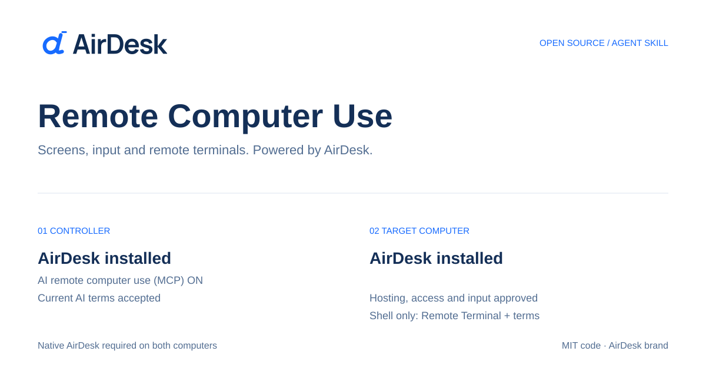

<p align="center">
  
</p>

# AirDesk Remote Computer Use

[한국어](README.ko.md) · [Setup](skills/remote-computer-use/references/setup.md) · [Security](SECURITY.md) · [Validation](docs/validation.md)

An open-source **Agent Skill** for operating authorized remote computers through
AirDesk's native MCP server: screenshots, mouse and keyboard input, remote
terminals, Windows/macOS desktop automation, and browser UI through the bundled agent-desktop engine.

> **Install AirDesk on both computers and enable AI remote computer use on the controller.**
> Accept the current AI terms in the controller app. The target must be running,
> sharing and approved for the intended user. Desktop and browser automation
> require the applicable input permission. Shell work also requires the target's
> Remote Terminal setting and current host terms.

## What's Included

- A portable [Agent Skill](skills/remote-computer-use/SKILL.md), with explicit
  consent, coordinate mapping, verification, and cleanup instructions, including
  the integrated agent-desktop accessibility tools (`remote_desktop_*`) when the
  AirDesk build advertises them.
- A dependency-free Python setup helper that prints MCP configuration or checks
  **local** prerequisites without connecting to a target.
- An npm installer that installs the skill, registers the native MCP server,
  and enables only the controller's MCP mode through AirDesk itself.
- The skill in **English, Korean and Japanese** (`--lang en|ko|ja`), installed
  under the same `remote-computer-use` name.
- **Online MCP** support (`https://mcp.airdesk.co.kr/mcp`, OAuth or API key) for
  Claude and ChatGPT connectors, including their mobile apps, and for coding
  agents, plus a Claude Code plugin marketplace in all three languages.
- English/Korean documentation, security guidance, regression tests, and CI.
- Existing AirDesk identity assets and a Figma-authored repository cover.

## Quick Start

Install [AirDesk](https://airdesk.co.kr) on both computers. On the controller, enable
**AI remote computer use** and review/accept the current AI remote-access terms in the
app. Older builds call this setting **MCP server** or **MCP mode**. Then ask your
AI agent to install this GitHub repository on the controller:

> Install https://github.com/AirDesk-Inc/remote-computer-use.git.
> Enable this computer's AirDesk AI remote computer use and register its native MCP server.
> Leave this computer's Remote Terminal hosting setting unchanged.

By default the installer copies the skill to `~/.agents/skills/` and adds an
`airdesk` server to the Codex configuration, preserving unrelated settings. To
set up every supported coding agent already present on the computer at once, use
`--client detected`; to pick specific agents, pass their ids, comma-separated
(for example `--client claude-code,cursor,gemini-cli`). See
[Supported coding agents](#supported-coding-agents). The installer enables
MCP once during installation, not on every server startup; terms are never
accepted automatically. Reload your MCP client. The target owner approves host
access. For shell work, verify support, activation and current host terms in the
selected computer's `targetRemoteTerminal` report.

### Install from AirDesk or GitHub

The [AirDesk website](https://airdesk.co.kr/en/service#mcp) provides the
current one-line installer. For the examples below, clone the official GitHub
repository and run them from its root with Node.js 22 or later.

```sh
git clone https://github.com/AirDesk-Inc/remote-computer-use.git
cd remote-coumputer-use
npm ci --ignore-scripts
node bin/cli.mjs install                                    # Codex (default)
node bin/cli.mjs install --client detected                  # every supported agent found here
node bin/cli.mjs install --client claude-code,cursor
node bin/cli.mjs clients                                    # list agents, paths, detection
node bin/cli.mjs install --lang ko                          # Korean skill (en, ko, ja)
node bin/cli.mjs install --mode online --client claude-code
```

**Language.** `--lang` picks the skill language. Without it the installer asks
in an interactive terminal and otherwise follows the system locale (English
when unknown). The folder name, trigger (`rcu`) and MCP tool names are the same
in every language. Switching an installed copy to another language needs
`--upgrade` and keeps the previous copy as a backup.

### Online MCP, mobile and plugins

Online MCP supports an account-owned target in **direct mode** (`direct_host`)
when the tool catalog advertises it. Use the existing account API key or OAuth
grant and follow [direct discovery and connection](skills/remote-computer-use/references/online.md#direct-host-without-a-bridge).
App launches follow the target's [direct app launch policy](skills/remote-computer-use/references/online.md#direct-app-launch).

Online clients connect directly to the gateway, including on web and mobile.

| Where | How |
| --- | --- |
| Claude web, desktop and **mobile** | Settings → Connectors → Add custom connector → `https://mcp.airdesk.co.kr/mcp`, approve in AirDesk. Upload the skill from `node bin/cli.mjs pack --lang ko` run in the checkout. |
| ChatGPT | Developer mode → add a custom MCP server with the same URL and OAuth. |
| Claude Code plugin | `/plugin marketplace add AirDesk-Inc/remote-computer-use`, then install `remote-computer-use`, `remote-computer-use-ko` or `remote-computer-use-ja`. |
| Coding agents | `install --mode online --client <id>` (`codex`, `claude-code`, `cursor`, `vscode`, `gemini-cli`, `opencode`, `generic`). Add `--auth key` to read an API key from `AIRDESK_MCP_KEY` instead of OAuth. |

After signing in to AirDesk, choose scopes (`observe`, `input`, `terminal`),
expiry and allowed computers, then approve in the browser.
Revoke grants and keys in AirDesk My Page. See the [online guide](skills/remote-computer-use/references/online.md) and
[connectors](docs/connectors.md).

Use `--binary` with the trusted AirDesk executable's absolute path on Windows or
nonstandard installs. `--dry-run` previews without executing AirDesk or writing
files; `--skip-mcp` installs only the skill. Conflicting skills/configuration are
not overwritten. The MCP server is always registered as `airdesk`. A native AirDesk server already registered under another name (command `AirDesk`/`AirDesk.exe` with `--mcp-server`, for example `default-server`) is renamed to `airdesk`, or removed as a duplicate when a correct `airdesk` entry exists; the result lists it in `mcpRenamedToAirdesk` and keeps a `configBackup`. Proxies, URLs and other launchers cannot be identified as AirDesk and are left unchanged. An unchanged install of an installer-recognized official release
(see [setup](skills/remote-computer-use/references/setup.md) for the supported
versions) can be explicitly upgraded with `--upgrade`; its full previous
directory is retained as a backup. Custom or modified files, which fail the
exact-hash check, are refused. Use `--upgrade --skip-mcp` for a skill-only update.
Automatic setup requires an AirDesk build supporting `--mcp-server --mcp-setup` and current
consent metadata. Older builds must be updated; manual configuration cannot
establish missing consent status.
See [full setup](skills/remote-computer-use/references/setup.md) and
[npm release guide](docs/npm-release.md). Never add account tokens to MCP
configuration or expose the server publicly.

### Supported coding agents

Client definitions follow each agent's documented user-scope defaults.
`--client detected` selects
only agents whose own folder already exists (the `detected` field of
`clients`); `--config` and `--skills-dir` override paths for a single client.

| Agent | `--client` | MCP configuration (macOS/Linux; Windows uses `%APPDATA%` for app folders) | Skill folder |
| --- | --- | --- | --- |
| Codex | `codex` | `$CODEX_HOME/config.toml` or `~/.codex/config.toml` | `~/.agents/skills` |
| Claude Code | `claude-code` | `~/.claude.json` (user scope) | `~/.claude/skills` |
| Claude Desktop | `claude-desktop` | `claude_desktop_config.json` in the app's data folder | manual import |
| Cursor | `cursor` | `~/.cursor/mcp.json` | `~/.cursor/skills` |
| Windsurf | `windsurf` | `~/.codeium/windsurf/mcp_config.json` | `~/.codeium/windsurf/skills` |
| Gemini CLI | `gemini-cli` | `~/.gemini/settings.json` | `~/.gemini/skills` |
| Antigravity | `antigravity` | `~/.gemini/config/mcp_config.json` | `~/.gemini/config/skills` |
| VS Code (GitHub Copilot) | `vscode` | `Code/User/mcp.json` (`servers` key) | `~/.copilot/skills` |
| GitHub Copilot CLI | `copilot-cli` | `~/.copilot/mcp-config.json` | `~/.copilot/skills` |
| Cline | `cline` | VS Code `globalStorage/saoudrizwan.claude-dev/settings/cline_mcp_settings.json` | `~/.agents/skills` |
| Roo Code | `roo-code` | VS Code `globalStorage/rooveterinaryinc.roo-cline/settings/mcp_settings.json` | `~/.roo/skills` |
| OpenCode | `opencode` | `~/.config/opencode/opencode.json` (`mcp` key) | `~/.config/opencode/skills` |
| Kiro | `kiro` | `~/.kiro/settings/mcp.json` | `~/.kiro/skills` |
| Qwen Code | `qwen-code` | `~/.qwen/settings.json` | `~/.qwen/skills` |
| Factory Droid | `droid` | `~/.factory/mcp.json` | `~/.factory/skills` |
| Trae | `trae` | `Trae/User/mcp.json` | `~/.trae/skills` |
| CodeBuddy | `codebuddy` | `~/.codebuddy/mcp.json` | `~/.codebuddy/skills` |
| Qoder | `qoder` | `~/.qoder/settings.json` | `~/.qoder/skills` |
| Devin for Terminal | `devin` | `~/.config/devin/mcp_config.json` | `~/.config/devin/skills` |
| Any other `mcpServers` JSON client | `generic` | `--config PATH` (required) | `~/.agents/skills` (not verified) |

Every selected configuration is parsed and checked before anything is written; a
conflict in any one stops the whole run. Agents that share a skill folder get one
copy. Each JSON file is retained as a backup before replacement, and an
unchanged entry is left byte-for-byte. Files with comments (JSONC, common in
VS Code and Zed settings) are refused as `invalid_existing_json`: add the entry
by hand using the shape in the [setup guide](skills/remote-computer-use/references/setup.md#other-local-mcp-clients).
Quit Claude Desktop fully before installing, since it rewrites its configuration
while running. Agents not listed (Zed, Goose, Amp, Continue and others) can use
`--skip-mcp --skills-dir PATH` plus manual MCP configuration.

### Skill-only alternative (skills CLI)

The [skills CLI](https://github.com/vercel-labs/skills) can install just the
skill files:

```sh
npx skills add AirDesk-Inc/remote-computer-use --skill remote-computer-use
```

Add `--list` to list the repository's skills without installing. By default the
skill is installed for the current project; `-g` installs it globally and `-a`
selects the agent client(s). This does **not** register the native MCP server,
enable AirDesk MCP mode, accept terms or run the npm installer's AirDesk setup
checks. Complete the MCP setup separately, as described in
[setup](skills/remote-computer-use/references/setup.md).

Ask your agent, for example:

> Use $remote-computer-use to inspect the display on my authorized office PC.
> Both computers have AirDesk. Controller MCP is on with current AI terms
> accepted, and I have approved target access. Ask me to select ambiguous targets.
> If shell work is needed and target Remote Terminal is OFF, ask me to enable it and wait for confirmation.

That example states conditions you must have confirmed; do not assert any that
are not true. Keep your client's tool approval controls enabled.

`$remote-computer-use` is Codex's explicit skill syntax. Other clients use their
own mechanism (for example `/remote-computer-use` in Claude Code) or pick the
skill from its description; the skill name is always `remote-computer-use`.

You can shorten the skill name to `rcu` or `RCU` in conversation:

> Use rcu with AirDesk to inspect the display on my authorized office PC.

This is conversational shorthand only. Package, executable and MCP tool names are
unchanged, and the same setup and approval requirements apply.

Native MCP/RCU remote-desktop connections must open a **real interactive remote window
on the controller**, not an observation-only window. The default policy and the
skill explicitly use `video:true,showWindow:true`, with local mouse/keyboard
forwarding and the normal toolbar, subject to existing host input permissions.
Manual and AI input share the window: pause AI input during user interaction,
then re-observe after handback before resuming. Native MCP/agent ownership,
session IDs and cleanup remain in force. Closing the real window ends its owned
MCP session and initiates owned-terminal/held-input cleanup; do not silently reconnect.

The window's automatic clipboard capture and sync remain disabled for MCP ownership.
Opening the window does not enable audio; microphone, overlay and recording
settings are unchanged. Do not expect automatic clipboard or audio. Explicit
clipboard tools (`remote_desktop_clipboard_get` / `remote_desktop_clipboard_set`), if advertised, are
separate actions that work independently of that sync and need task
authorization. Headless (`video:true,showWindow:false`) and no-video (`video:false`,
which also disables the window) modes require the user's explicit request.
If the native schema lacks `showWindow` or the build only opens an observation-only
window, stop desktop input and request a compatible app update instead of silently
falling back. Installing the skill alone does not update the native app or prove
interactive behavior. See [connection modes](skills/remote-computer-use/references/screen-control.md#session-window).

## Optional Local Check

Python 3.10+ is only required for this helper, not the native MCP connection:

```sh
python3 skills/remote-computer-use/scripts/airdesk_mcp.py doctor
python3 skills/remote-computer-use/scripts/airdesk_mcp.py config --client codex
```

On Windows/nonstandard installs, pass `--binary` with the trusted executable's
absolute path. The helper never installs apps, enables settings, modifies client
configuration, or performs a remote action.

**A successful local check does not verify target access.** `remote_status`
reports the controller's MCP settings, not target permission approval. Verify
host sharing/access separately. For shell work, read the target's
`targetRemoteTerminal` status from fresh discovery. Absent fields are unknown.
The diagnostic distinguishes missing consent, an OFF switch and an unavailable
policy. Optional controller tool groups are reported separately from core tools;
their presence does not verify target compatibility. It checks core agent-desktop tool names and the ref-based click schema, but
does not execute target operations; the live tool catalog is authoritative.

## Capabilities and Boundaries

| Capability | Contract |
| --- | --- |
| Computer discovery / connection | Authenticated AirDesk account and host approval; confirm controller MCP before connection; one host per MCP process. |
| Screenshots / display selection | Use the supported agent-desktop screenshot and display tools with their own coordinate contract. |
| Mouse / keyboard / text | Use agent-desktop input tools; wait for input readiness and verify the observed result. |
| Remote terminals | Compatible Windows/macOS targets, approved terminal access; inspect command-level completion. |
| App / window / element automation | Use agent-desktop discovery and fresh snapshots. macOS requires OS Accessibility permission. |
| macOS context menus | On compatible hosts, use the current popup observation and its verified item ref for one Accessibility press. See the [macOS context menu guide](skills/remote-computer-use/references/platform-macos.md#context-menus). |
| Integrated agent-desktop (`remote_desktop_*`) | Used by the skill for screen and window automation after controller and target access checks pass. Runs on the remote host's owned helper with fresh native refs. Refs expire on disconnect; Windows-spawned apps may close with the session. See the [agent-desktop guide](skills/remote-computer-use/references/agent-desktop.md). |
| Safari/Firefox DOM, mobile MCP, standalone Linux hosting | Not supported. Use agent-desktop tools where available. |

Actual availability depends on the installed AirDesk build, target platform,
permissions, and negotiated tools. Publication of this skill does not certify
every app build or end-to-end remote workflow. See [validation](docs/validation.md).
The former screen/window and CDP/DOM MCP APIs are removed. UI automation uses
`remote_desktop_*` exclusively, without compatibility aliases.

The AI uses AirDesk's `terminal_*` tools for target-side shell work and
`remote_desktop_list_windows` / `remote_desktop_snapshot` for UI discovery.
Use the engine's returned window IDs and qualified refs. A compatible native
AirDesk app is required on each computer; installing this skill alone does not
upgrade an older host.

### Remote Terminal

Compatible Windows and macOS target shells are supported, on all plans
including Free. Use `terminal_open` → `terminal_write` → cursor-based
`terminal_read` → `terminal_close`; `terminal_resize` changes the PTY geometry.

When the target's Remote Terminal setting is ON and the owner has accepted the
current in-app host terms, no additional per-session approval is required. If it
is OFF, the agent asks you to enable it before shell work. Queued input is not
command completion: inspect output, exit status and the intended effect. See the
[terminal workflow and examples](skills/remote-computer-use/references/terminal.md).

## Development

```sh
npm ci --ignore-scripts
npm test
npm run check:package
python3 -m unittest discover -s tests -v
python3 -m compileall -q skills/remote-computer-use/scripts tests
```

Tests use local subprocess fixtures, never real accounts or remote computers.
CI runs the same tests on macOS, Windows, and Linux with Python 3.10 and 3.13.
Linux CI validates the helper, not AirDesk host support.
See [contributing](CONTRIBUTING.md) before opening a change.

## License and Brand

Original skill text, scripts, documentation, and tests: **[MIT](LICENSE)**.
The agent-desktop guides adapt [vercel-labs/agent-desktop](https://github.com/vercel-labs/agent-desktop)
skills under the Apache License 2.0; see
[THIRD_PARTY_NOTICES.md](skills/remote-computer-use/THIRD_PARTY_NOTICES.md) and the bundled
[license text](skills/remote-computer-use/licenses/agent-desktop-LICENSE.txt).
AirDesk app binaries/source are not relicensed by this repository.
AirDesk logos, wordmarks, and branded imagery are excluded from MIT and covered
by [separate brand terms](TRADEMARKS.md). No trademark rights or endorsement are
granted by the software license.

The repository URL intentionally retains `remote-coumputer-use`; the installed
skill is named `remote-computer-use`.
